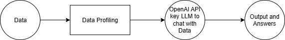
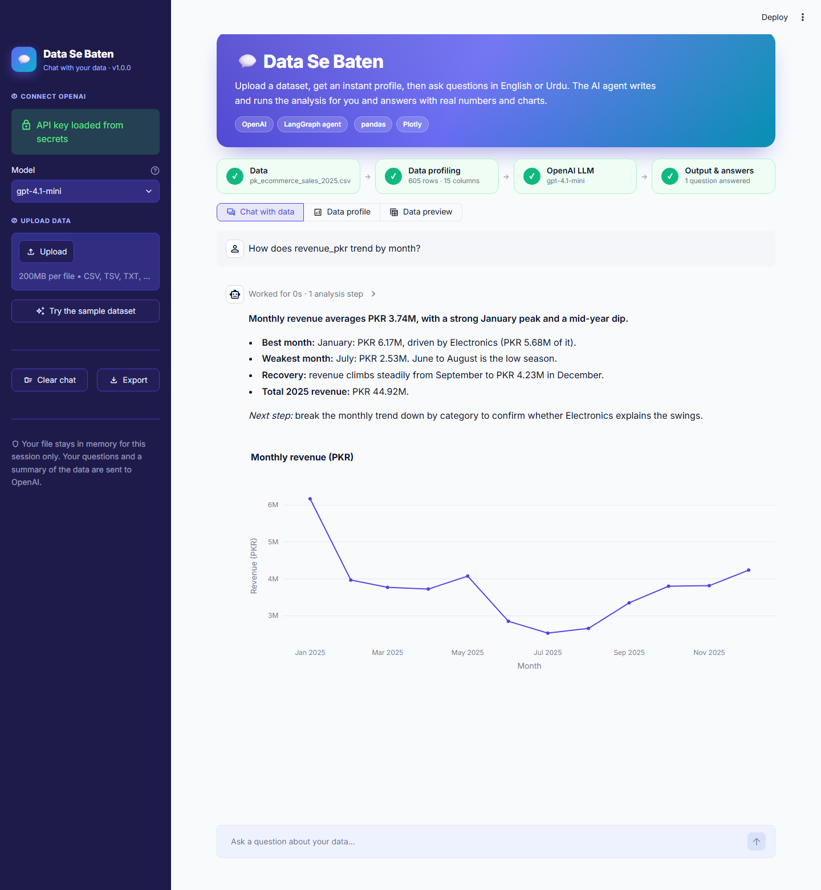
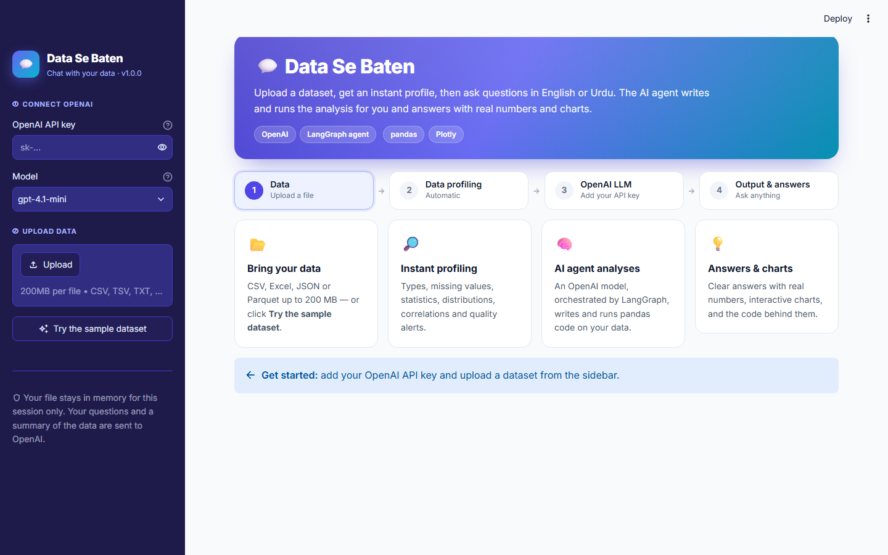
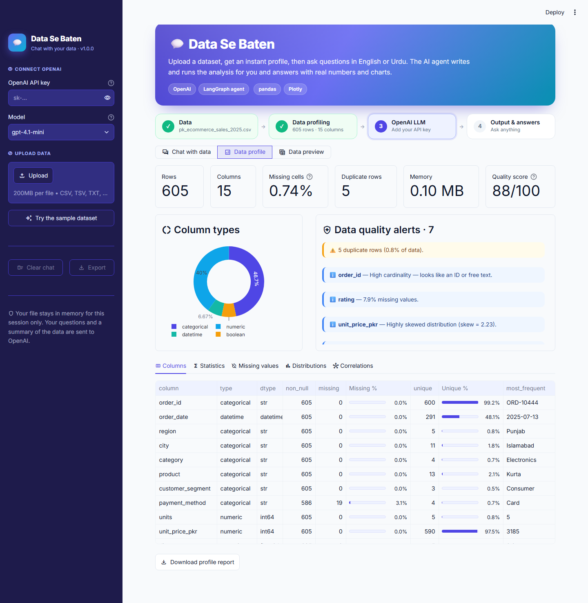

# Data Se Baten — User & Deployment Guide

> **Data Se Baten** (Urdu for *"talking with data"*) is an AI agent that lets you upload a dataset, get an
> automatic data profile, and ask questions in plain English, Urdu or Roman Urdu. An OpenAI model writes and
> runs the analysis for you and replies with real numbers and interactive charts.

---

## 1. What the agent does

The agent follows a four-step workflow:



| Step | What happens | Where in the code |
|---|---|---|
| **1. Data** | You upload CSV, TSV, Excel, JSON or Parquet (up to 200 MB), or use the built-in sample. | `profiling.load_data` |
| **2. Data Profiling** | Column types, missing values, duplicates, statistics, distributions, correlations, quality alerts and a 0–100 quality score. | `profiling.profile_data` |
| **3. OpenAI LLM** | A LangGraph agent gets the profile as context. For each question it writes pandas / Plotly code and runs it against your data. | `agent.build_agent` |
| **4. Output & Answers** | A Markdown answer with the key numbers, any charts, and a collapsible *"Worked for … · N analysis steps"* panel with the exact code it ran. | `app.render_chat` |



### Key features

- **Instant profiling dashboard.** KPI cards, a column-type donut, quality alerts, and tabs for columns, statistics, missing values, distributions and correlations.
- **Chat with your data.** Ask follow-up questions; the agent remembers the conversation.
- **Grounded answers.** The agent computes every number with code instead of guessing.
- **Interactive charts.** Ask for a chart and you get a Plotly chart you can zoom and hover.
- **Transparent.** Every answer shows the Python code behind it.
- **Bilingual.** It replies in the language you write in.
- **Exports.** Download the profile report (.md), the chat transcript (.md) and the dataset (.csv).

---

## 2. Project structure

```text
ai_agent_to_deployment/
├── app.py                        # Streamlit app (UI + workflow)
├── data_se_baten/
│   ├── __init__.py               # app name & version
│   ├── profiling.py              # Step 2: loading + data profiling
│   └── agent.py                  # Step 3: LangGraph + OpenAI agent and its tool
├── sample_data/
│   └── pk_ecommerce_sales_2025.csv   # demo dataset (605 orders, 15 columns)
├── .streamlit/
│   ├── config.toml               # theme & upload limit
│   └── secrets.toml.example      # template for your OpenAI key
├── requirements.txt              # dependencies for Streamlit Community Cloud
├── docs/screenshots/             # images used in this guide
├── GUIDE.md / .html / .pdf / .docx
└── workflow.png
```

---

## 3. Run it on your computer

### 3.1 Prerequisites

- **Python 3.11 – 3.13** ([python.org](https://www.python.org/downloads/))
- **An OpenAI API key.** Create one at <https://platform.openai.com/api-keys>. Your account needs billing credit.

### 3.2 Set up the virtual environment

**Windows (PowerShell)**

```powershell
cd "path\to\ai_agent_to_deployment"
py -3.13 -m venv .venv
.\.venv\Scripts\Activate.ps1
python -m pip install --upgrade pip
pip install -r requirements.txt
```

> If PowerShell blocks `Activate.ps1`, run `Set-ExecutionPolicy -Scope CurrentUser RemoteSigned` once,
> or skip activation and call `.\.venv\Scripts\python.exe` directly.

**macOS / Linux**

```bash
cd path/to/ai_agent_to_deployment
python3 -m venv .venv
source .venv/bin/activate
pip install --upgrade pip
pip install -r requirements.txt
```

### 3.3 Add your API key (optional but recommended)

Copy `.streamlit/secrets.toml.example` to `.streamlit/secrets.toml` and put your key in it:

```toml
OPENAI_API_KEY = "sk-..."
```

If you skip this, you can paste the key into the sidebar each time you open the app. You can also set an
`OPENAI_API_KEY` environment variable.

### 3.4 Start the app

```bash
streamlit run app.py
```

Your browser opens at <http://localhost:8501>. On Windows without activating the venv:

```powershell
.\.venv\Scripts\python.exe -m streamlit run app.py
```

---

## 4. Using the app



### 4.1 Sidebar

1. **① Connect OpenAI.** Paste your API key, or you'll see *"API key loaded from secrets"* if you set one up. Choose a **model**. `gpt-4.1-mini` is fast and cheap, and you can type any other OpenAI chat model name.
2. **② Upload data.** Drag a file in, or click **Try the sample dataset**.
3. **Clear chat / Export.** Start over, or download the conversation as Markdown.

The **workflow bar** at the top tracks your progress through *Data → Data Profiling → OpenAI LLM → Output & Answers*.
Completed steps turn green and the current step is highlighted. Below it, switch between the three views:
**Chat with data**, **Data profile** and **Data preview**.

### 4.2 Chat with data

- Click a **suggested question** or type your own in the box at the bottom.
- A **"Thinking"** indicator shows each analysis step (the code, then its output) while it runs.
- The answer appears with its **charts** below it.
- Click **Worked for … · N analysis steps** above an answer to see the exact code and output behind it.

**Example questions** (for the sample dataset):

| Type | Example |
|---|---|
| Summary | *Give me an executive summary of this dataset* |
| Aggregation | *What is total revenue by region? Which region is best?* |
| Ranking | *Top 5 products by revenue, with their average rating* |
| Trend | *Show monthly revenue as a line chart* |
| Comparison | *Do Corporate customers spend more per order than Consumers?* |
| Data quality | *Which columns have problems and how should I clean them?* |
| Statistics | *Is there a relationship between discount and rating?* |
| Urdu / Roman Urdu | *Sab se zyada returns kis category mein hain?* |

**Tips for good answers**

- Use the column names you see in the profile.
- Ask for a chart explicitly: *"…as a bar chart"*, *"…plot it"*.
- Build on earlier answers: *"now break that down by city"*.
- If an answer looks wrong, open the analysis steps and tell the agent what to change.

### 4.3 Data profile



| Section | What it shows |
|---|---|
| KPI cards | Rows, columns, missing %, duplicate rows, memory, **quality score** |
| Column types | Donut of numeric / categorical / datetime / boolean columns |
| Quality alerts | Duplicates, heavy missingness, constant columns, ID-like columns, skew, outliers (IQR rule), near-duplicate columns (\|r\| ≥ 0.9) |
| Columns tab | Per-column type, missing %, unique %, most frequent value |
| Statistics tab | `describe()` + skew for numeric columns; count/unique/top for categorical |
| Missing values tab | Bar chart of missing % per column |
| Distributions tab | Histogram + box plot (numeric), monthly counts (dates) or top-20 values (categorical) |
| Correlations tab | Pearson correlation heatmap |

Click **Download profile report** to save it as Markdown.

### 4.4 Data preview

This view has a scrollable, sortable, searchable table of the full dataset and a CSV download button.

---

## 5. How it works (for developers)

### 5.1 The LangGraph agent

```text
        ┌──────────────────────────────┐
START ─►│ agent  (OpenAI chat model)   │── no tool call ─► END  (final answer)
        └──────────────┬───────────────┘
                       │ tool call
                       ▼
        ┌──────────────────────────────┐
        │ tools  (python_analysis)     │── result ─► back to agent
        └──────────────────────────────┘
```

- **State:** a list of messages (`AgentState` with the `add_messages` reducer).
- **System prompt:** the role, the rules, and the **data profile text** from step 2, so the model knows the columns, types and data-quality issues before it writes any code.
- **Tool `python_analysis(code)`:** runs code with `df`, `pd`, `np`, `px` and `go` in scope, on a *copy* of the data. It returns the printed output and last expression to the model (truncated to 6 000 characters). Plotly figures and tables go back to the UI as *artifacts* and are never sent to the model.
- **Self-correction:** if code raises an error, the error text goes back to the model and it retries.
- **Memory:** earlier questions and final answers (the last 12 turns) are replayed each time, which keeps token usage low.
- **Safety limit:** `recursion_limit = 24` graph steps per question.

### 5.2 Customising

| What | Where |
|---|---|
| Colours, fonts, radius | `.streamlit/config.toml` and the CSS block at the top of `app.py` |
| Model list / default model | `MODELS` in `app.py`, or `OPENAI_MODEL` in secrets |
| Agent behaviour / tone | `SYSTEM_PROMPT` in `data_se_baten/agent.py` |
| Extra tools (e.g. SQL, web search) | Add a `@tool` in `make_tools()`; LangGraph wires it automatically |
| Profiling rules and alert thresholds | `_build_alerts()` in `data_se_baten/profiling.py` |
| Upload size limit | `maxUploadSize` in `.streamlit/config.toml` |

---

## 6. Deploy to Streamlit Community Cloud

1. **Push the project to GitHub.** Commit everything *except* `.venv/` and `.streamlit/secrets.toml` (the included `.gitignore` already excludes both).
   ```bash
   git init
   git add .
   git commit -m "Data Se Baten AI agent"
   git branch -M main
   git remote add origin https://github.com/<you>/data-se-baten.git
   git push -u origin main
   ```
2. Go to <https://share.streamlit.io> and sign in with GitHub.
3. Click **Create app → Deploy a public app from GitHub**.
4. Pick your **repository**, set **branch** = `main` and **main file path** = `app.py`.
5. Open **Advanced settings**:
   - **Python version:** 3.12 or 3.13 (3.11 minimum).
   - **Secrets:** paste
     ```toml
     OPENAI_API_KEY = "sk-..."
     ```
     Skip this if you want every visitor to use their own key through the sidebar.
6. Click **Deploy**. The first build installs `requirements.txt` and takes 2–5 minutes.
7. Share your app URL (`https://<your-app>.streamlit.app`).

> ⚠️ **Cost warning:** if you put *your* key in Secrets, every visitor's questions are billed to you.
> For a public app, leave Secrets empty so visitors bring their own key, or set a monthly spending limit at
> <https://platform.openai.com/settings/organization/limits>.

**To update the app,** push to GitHub and Streamlit Cloud redeploys automatically. To change the key, go to
**App → Settings → Secrets**.

---

## 7. Troubleshooting

| Problem | Fix |
|---|---|
| *"Your OpenAI API key was rejected"* | Check the key has no spaces, is active, and your account has billing credit. |
| *"Rate limit or quota reached"* | Wait a minute, add credit, or switch to a smaller model. |
| *"Model … isn't available"* | Your key has no access to that model. Pick `gpt-4.1-mini` or `gpt-4o-mini`. |
| *"Could not read file"* | Save Excel as `.xlsx` (not password-protected), or export as UTF-8 CSV. |
| *"Too many steps"* | Ask a more specific question, or split it into two. |
| `streamlit` not recognised | Activate the venv, or use `.\.venv\Scripts\python.exe -m streamlit run app.py`. |
| Cloud build fails | Check the logs under **Manage app**. Usually a typo in `requirements.txt` or an unsupported Python version. |
| App is slow on big files | Profiling is cached per file. For files over 1M rows, sample them first. |

---

## 8. Privacy & security

- Uploaded data lives **in memory for your session only**. Nothing is written to disk.
- The **data profile, the first five rows and tool outputs** (aggregated results) are sent to OpenAI to answer questions. Don't upload data you aren't allowed to share with OpenAI.
- API keys typed in the sidebar are kept only in that browser session.
- The agent runs **model-generated Python** on the server. That's fine for personal and classroom use. For a multi-tenant production system, run the tool in an isolated sandbox (a container or a service such as E2B) and add authentication.

---

## 9. FAQ

**Which files are supported?** CSV, TSV, TXT (delimiter auto-detected), XLSX, JSON / JSON-lines and Parquet. Save old `.xls` files as `.xlsx` first.

**Can I use a model other than OpenAI?** Yes. Replace `ChatOpenAI` in `agent.py` with any LangChain chat model that supports tool calling (for example `ChatAnthropic`) and add its package to `requirements.txt`.

**How much does a question cost?** A question usually takes 1–3 model calls, each sending the data profile (about 1,000 tokens) plus the conversation. Smaller models such as `gpt-4.1-mini` cost far less than larger ones. See <https://openai.com/api/pricing> for current prices.

**Does it remember previous chats after I close the tab?** No. Use **Export** in the sidebar to keep a copy.

---

*Data Se Baten v1.0.0 — built with Streamlit, LangGraph, LangChain-OpenAI, pandas and Plotly.*
