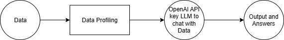
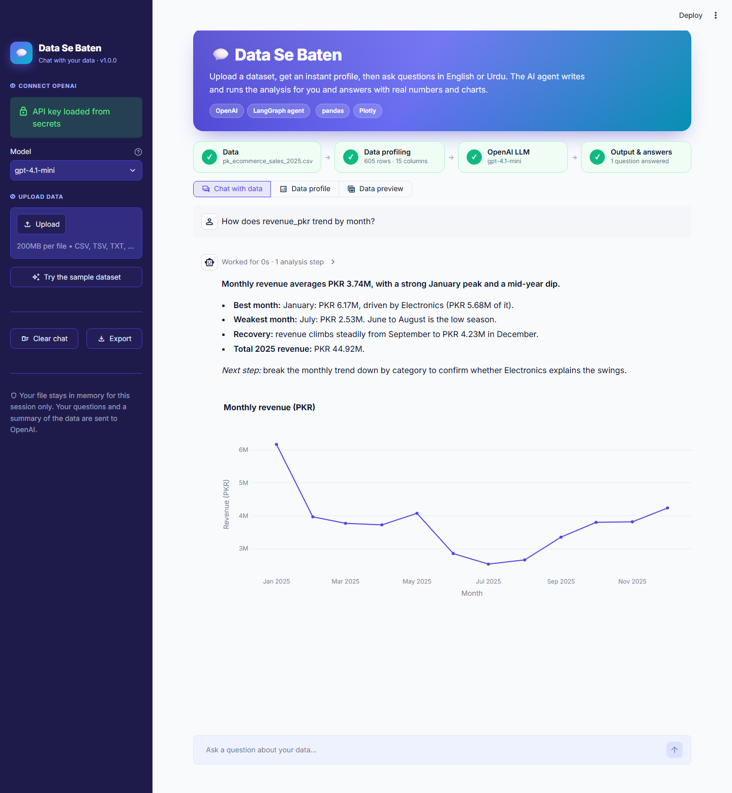

# 💬 Data Se Baten — chat with your data

An AI agent built with **Streamlit + OpenAI + LangGraph**. Upload a dataset, get an automatic data profile,
then ask questions in plain English or Urdu. The agent writes and runs pandas code and answers with real
numbers and interactive charts.





## Quick start

```bash
python -m venv .venv
# Windows: .\.venv\Scripts\Activate.ps1    macOS/Linux: source .venv/bin/activate
pip install -r requirements.txt
streamlit run app.py
```

Paste your OpenAI API key in the sidebar, or put it in `.streamlit/secrets.toml`
(see `.streamlit/secrets.toml.example`). Then click **Try the sample dataset**.

## Deploy to Streamlit Community Cloud

Push this folder to GitHub → [share.streamlit.io](https://share.streamlit.io) → **Create app** → main file
`app.py` → optionally add `OPENAI_API_KEY` under **Advanced settings → Secrets** → **Deploy**.

## Documentation

The full user and deployment guide is available as [GUIDE.md](GUIDE.md), [GUIDE.html](GUIDE.html),
[GUIDE.pdf](GUIDE.pdf) and [GUIDE.docx](GUIDE.docx).
